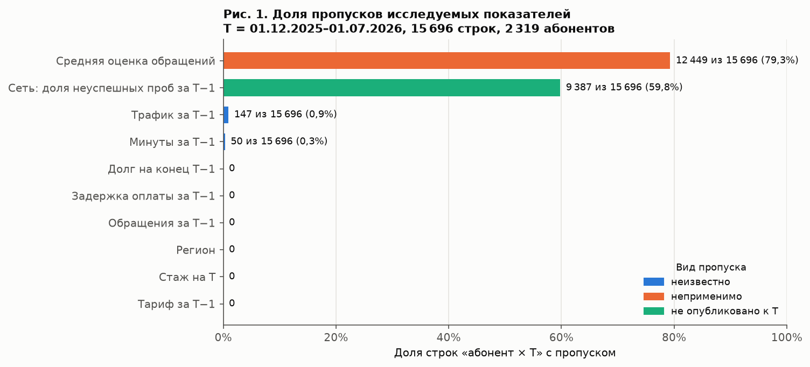
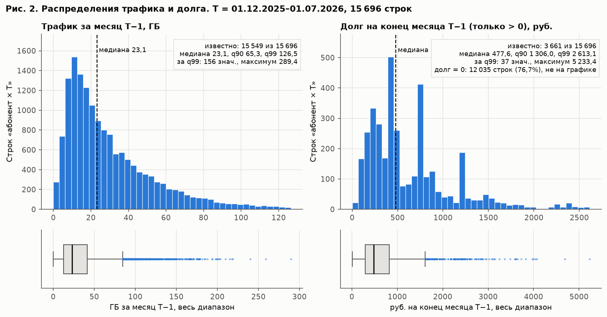
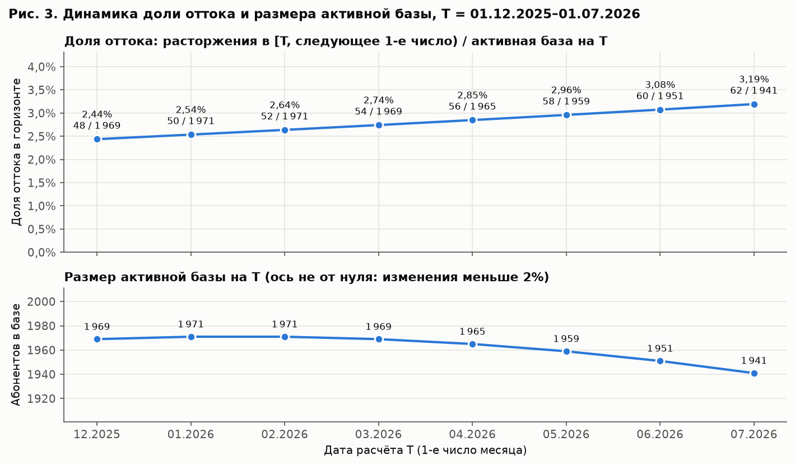
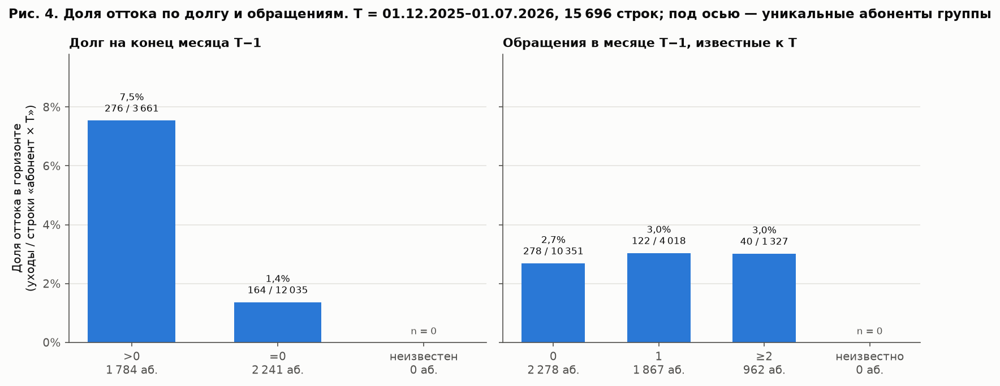
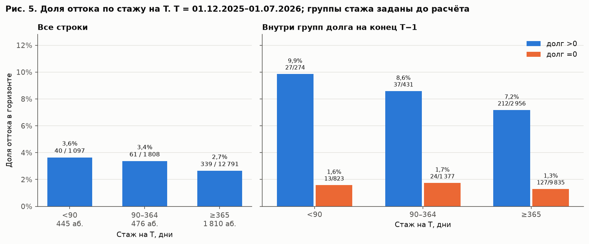
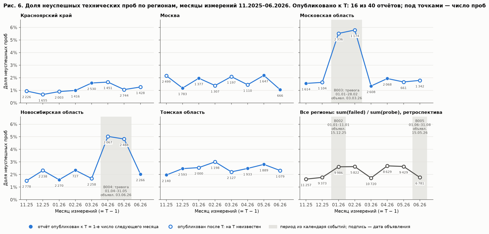

# Отчёт по разведочному анализу

Команда: Евгений (индивидуально). Версия репозитория: [github.com/Dakera/tsu_practicum/lesson3](https://github.com/Dakera/tsu_practicum/tree/main/lesson3). Дата запуска: 24.10.2026.

Все числа получены запуском `lesson3/eda.ipynb` и совпадают с файлами в `lesson3/output/`. Пути к таблицам ниже указаны относительно `lesson3/output/`.

## 1. Цель и исследуемая база

Вопросы исследования:
- как меняется доля оттока по датам расчёта;
- отличаются ли абоненты с долгом и без него;
- связаны ли обращения в поддержку с последующим уходом;
- отличаются ли группы по стажу и не объясняется ли это составом групп;
- можно ли использовать технические измерения сети на дату расчёта.

| Параметр | Принятое правило |
|---|---|
| Единица наблюдения | Пара `(customer_id, snapshot_at)`: абонент на дату расчёта T |
| Даты T для EDA | 01.12.2025 – 01.07.2026, 8 дат, 00:00 МСК первого числа |
| Валидация и тест | 01.08.2026 и 01.09.2026; в EDA не строятся и не смотрятся |
| Активная база и границы T | `activation < T` и (нет `termination` или `termination ≥ T`): состояние до событий на T. Подключение в день T не входит, расторжение в день T — отток месяца T |
| Горизонт и исключённый конец | Календарный месяц `[T, 1-е число следующего месяца)`. Если конец позже 01.10.2026, метка неизвестна (не 0) |
| Источники признаков и их доступность | Строка `customer_month` за месяц T−1 с `billing_available_at ≤ T`; справочник абонентов (постоянные поля); сетевой отчёт — отдельной таблицей, только при `report_available_at ≤ T` |

Число строк: 15 696. Уникальных абонентов: 2 319. Число наблюдаемых исходов: 15 696, из них 440 расторжений; строк с неизвестной меткой нет. На всех восьми датах присутствуют 1 627 абонентов, в среднем на абонента 6,77 строки. Размер базы и число уходов на каждой дате совпали с независимым пересчётом по сырому журналу и с таблицей устава.

## 2. Распределения и качество

Таблица: `tables/fig1_missing.csv`. Пропуски трёх видов:

- **неизвестно:** трафик за T−1 — 147 строк (0,9%), пропуск в источнике биллинга; минуты — 50 строк (0,3%), отрицательные значения переведены в пропуск на этапе 2. Ни то ни другое не заменяется нулём;
- **неприменимо:** средняя оценка обращений — 12 449 строк (79,3%), в месяце не было оценённых обращений, известных к T;
- **не опубликовано к T:** сетевой отчёт за T−1 — 9 387 строк (59,8%), отчёт региона вышел после 00:00 первого числа.

Долг, обращения, задержка оплаты, тариф, стаж и регион известны во всех строках. Группы «долг неизвестен» и «обращения неизвестны» пустые и показаны с n = 0.

Таблицы: `tables/fig2_distribution_summary.csv`, `tables/fig2_histogram_bins.csv`, `tables/numeric_summary.csv`, `tables/zeros_meaning.csv`, `tables/extremes_review.csv`.

- **Трафик** (15 549 известных значений): медиана 23,1 ГБ, q90 65,3, q99 126,5, максимум 289,4. Среднее 31,2 выше медианы — длинный правый хвост. Нулей нет. 147 из 155 строк верхнего 1% — тариф Premium, у всех начисление выше абонплаты: это сверхлимитное потребление, значения допустимы.
- **Долг** (15 696 значений): ноль у 12 035 строк (76,7%) — долга нет. Среди 3 661 строки с долгом медиана 477,6 руб., q90 1 306, максимум 5 233. Тождество `closing = opening + charged − paid` выполняется во всех строках, поэтому крупный долг — накопленная неоплата, а не ошибка. Пики около 450, 750 и 1 200 руб. — абонплата тарифов; ровно одна неоплаченная абонплата у 729 строк с долгом.
- **Содержательные нули:** нет оплаты в месяце — 1 829 строк, оплата без задержки — 8 705, обращений не было — 10 351.

## 3. Динамика и различия групп

Доля оттока — уходы в горизонте, делённые на строки «абонент × T». Один абонент входит в знаменатель на каждой дате, где он в базе, поэтому рядом с числом строк указано число абонентов.

Таблица: `tables/fig3_churn_by_T.csv`. Доля оттока растёт на каждой из 7 смен даты: от 2,44% (48 / 1 969) до 3,19% (62 / 1 941). База меняется на −1,4%, рост идёт за счёт числителя: уходов становится ровно на 2 больше каждый месяц. Такая равномерность похожа на свойство синтетического набора, а не на сезонность.

Таблица: `tables/fig4_churn_by_debt_support.csv`.

| Группа | Строк | Абонентов | Уходов | Доля |
|---|---:|---:|---:|---:|
| Долг > 0 | 3 661 | 1 784 | 276 | 7,5% |
| Долг = 0 | 12 035 | 2 241 | 164 | 1,4% |
| Долг неизвестен | 0 | 0 | 0 | — |
| 0 обращений | 10 351 | 2 278 | 278 | 2,7% |
| 1 обращение | 4 018 | 1 867 | 122 | 3,0% |
| ≥2 обращений | 1 327 | 962 | 40 | 3,0% |
| Обращения неизвестны | 0 | 0 | 0 | — |

Обратное сравнение (`tables/churners_vs_stayers.csv`): долг на конец T−1 был в 62,7% строк ушедших и в 22,2% строк оставшихся; медианный долг 441 и 0 руб. По трафику, минутам и стажу ушедшие и оставшиеся почти не различаются.

Таблицы: `tables/fig5_churn_by_tenure.csv`, `tables/churn_by_tariff.csv`, `tables/churn_by_region.csv`. Стаж <90 дней — 3,6% (40 / 1 097, 445 абонентов), 90–364 — 3,4% (61 / 1 808), ≥365 — 2,7% (339 / 12 791). Тарифы: Basic 2,5%, Comfort 3,0%, Premium 3,1%. Регионы: от 2,4% (Новосибирская область) до 3,2% (Красноярский край).

**Проверка альтернативных объяснений.** Связь с долгом повторена внутри каждого месяца, тарифа, группы стажа и региона (`tables/debt_within_strata.csv`): должники уходят чаще во всех 19 срезах, отношение долей от 3,9 до 7,5 раза. Значит, разница не объясняется тем, что должники сосредоточены в каком-то месяце, тарифе или регионе. Различие по стажу проверено внутри групп долга (рис. 5, справа): при стаже <365 дней доля выше, чем при ≥365, и среди должников, и среди абонентов без долга.

**Повторные наблюдения.** Интервалы для разниц долей посчитаны кластерным бутстрепом: абоненты пересэмплируются целиком, со всеми своими строками (`tables/rate_difference_intervals.csv`, 2 000 повторов). На этих данных кластерный интервал почти совпадает с наивным (для долга [5,27; 7,07] против [5,30; 7,06] п.п.): абонент уходит не больше одного раза, а метка редкая, поэтому строки одного человека слабо зависимы. Корреляции Спирмена с меткой (`tables/spearman_correlation.csv`): долг 0,17, задержка оплаты 0,13, оплата −0,11, остальные по модулю ниже 0,03. Долг и задержка оплаты почти дублируют друг друга (0,79).

## 4. Сеть и контекст

Таблицы: `network_availability.csv` (ключ `region, measurement_month, snapshot_at`), `tables/fig6_network_failed_probes.csv`, `tables/network_failed_rate_by_region_month.csv`, `tables/network_availability_summary.csv`.

Правило агрегирования проб: доля неуспешных проб = `failed_probe_count / probe_count`; для нескольких регионов делятся суммы, `sum(failed) / sum(probe)`. Среднее региональных долей отличается от этого до 0,25 п.п. и не используется. Общие p50/p90 из региональных квантилей не выводятся.

Число отчётов, доступных и недоступных на T: 16 и 24 из 40. Отчёты выходят через 0, 24, 36 или 48 часов после конца месяца; на каждую дату T известны ровно 2 региона из 5, постоянно опаздывающего региона нет. Последний известный на T отчёт — за T−1 в 16 случаях и за T−2 в 24; отчёт с лагом в два месяца известен всегда.

Тревожные месяцы — Московская область в январе и феврале 2026 (5,5% и 5,8% неуспешных проб) и Новосибирская область в апреле и мае (5,0% и 4,8%). Ни один из этих четырёх отчётов не был опубликован к соответствующей дате T. Ретроспективно доля оттока в этих ячейках «регион × T» составила 3,8%, 2,6%, 3,8% и 2,3% при общей 2,8%. Связи с ростом ошибок не видно. По 16 ячейкам, известным на T, корреляция Спирмена равна −0,24 (`tables/network_vs_churn_region_T.csv`). Это описательная оценка на 16 точках, вывода из неё нет.

Что даёт календарь событий (`tables/context_availability.csv`): B001 (миграция поддержки 01.11.2025), B002 (праздники) и B005 (лето) объявлены до описанных периодов. Весь период обращений в EDA (ноябрь 2025 – июнь 2026) лежит после миграции, поэтому число обращений сопоставимо. Календарь не присоединялся к абонентам.

Какие сообщения были опубликованы после описанного периода: B003 (Московская область, январь–февраль) объявлен 03.03.2026 и известен только с T = 01.04.2026; B004 (Новосибирская область, апрель–май) объявлен 03.06.2026 и известен с T = 01.07.2026. Использовать их как признак на более ранних датах — утечка.

Ограничения: проба — контрольная загрузка с отдельных точек, а не опыт конкретного абонента. Число проб не равно числу абонентов, выборка проб не случайна. Регионов пять, поэтому любой сетевой признак на уровне абонента фактически повторяет регион. Совпадение линий на графике не доказывает причинной связи.

## 5. Результаты гипотез

Правило: «поддерживается» — 95%-интервал разницы долей не включает 0; «не поддерживается» — включает 0, а разница меньше 0,5 п.п.; «данных недостаточно» — включает 0, а разница не меньше 0,5 п.п. Для H3 — изменение доли в одну сторону на каждой смене даты. Порог 0,5 п.п. выбран как практически незаметная для кампании разница. Полные формулировки — в `analysis_plan.csv`.

| Гипотеза | Результат и числа | График/таблица | Ограничение | Следующее действие |
|---|---|---|---|---|
| H1: долг на конец T−1 связан с уходом | Поддерживается: 7,5% против 1,4%, разница 6,2 п.п., интервал [5,3; 7,1]; выше во всех 19 срезах | Рис. 4; `debt_within_strata.csv` | Связь, не причина; долг и задержка оплаты дублируют друг друга | Признаки долга и оплаты за несколько доступных месяцев |
| H2: обращения за T−1 связаны с уходом | Не поддерживается: 2,7% / 3,0% / 3,0% при 0 / 1 / ≥2; разница 0,3 п.п., интервал [−0,2; 0,9] | Рис. 4; `churners_vs_stayers.csv` | Учтён только один месяц; обращение может следовать за решением уйти | Окно 2–3 месяца, тема billing |
| H3: доля оттока меняется по T | Поддерживается: рост на 7 из 7 смен, 2,44% → 3,19%; база −1,4% | Рис. 3; `fig3_churn_by_T.csv` | Восемь точек; ровный рост похож на свойство синтетического набора | Разбиение только по времени; дата T как признак уровня |
| H4: стаж связан с уходом | Данных недостаточно: 3,6% / 3,4% / 2,7%; разница «<90 против ≥365» 1,0 п.п., интервал [−0,1; 2,1] | Рис. 5; `fig5_churn_by_tenure.csv` | В группе <90 дней 40 уходов; один абонент переходит между группами | Стаж в днях и число месяцев истории как непрерывные признаки |

## 6. Переход к признакам

| Направление | Смысл | Источник | Доступность на T | Риск |
|---|---|---|---|---|
| 1. Долг и платёжная дисциплина в динамике | Долг на конец, задержка оплаты, отношение оплаты к начислению за 1–3 последних месяца, число месяцев с долгом. Самая сильная связь в EDA (H1) | `customer_month`, месяцы ≤ T−1 | Да, строка месяца M доступна 1-го числа месяца M+1 | Строка за месяц T — утечка: её `active_days` выдаёт уходящих. Долг и задержка почти дублируют друг друга. 40 значений долга восстановлены на этапе 2 |
| 2. Стаж и длина истории | Стаж в днях, число доступных месяцев биллинга, флаг неполного месяца подключения. Направление согласуется с уставом, но EDA не дал уверенности (H4) | Справочник абонентов, `customer_month` | Да, постоянные поля и прошлые месяцы | Малая группа новых абонентов. Объёмы неполного месяца подключения нужно нормировать на `active_days` |
| 3. Региональная сеть с известным лагом | Доля неуспешных проб из последнего опубликованного к T отчёта (лаг 1–2 месяца) с возрастом отчёта; сообщения календаря только при `announced_at ≤ T` | `network_availability.csv`, `business_context.csv` | Только последний опубликованный отчёт; T−2 известен всегда | Подстановка отчёта T−1 до публикации — утечка. Региональная мера не описывает опыт абонента; пять регионов. Связь с оттоком не подтверждена: признак может не дать пользы |

## 7. Проверки и воспроизводимость

Команда запуска из корня репозитория: `jupyter nbconvert --to notebook --execute --inplace lesson3/eda.ipynb`. Вход — результаты этапа 2 (`lesson2/output/`), новые источники (`lesson3/data/`), сырой журнал событий этапа 1 для независимой проверки.

Версии: Python 3.14; pandas 2.3.3, numpy 2.5.4, matplotlib 3.11.2, nbconvert 7.17.2, ipykernel 7.4.0 (`requirements.txt`). Конфигурация периода, горизонта и активной базы — `output/config.json`.

Все 19 проверок пройдены (`output/checks.csv`).

| Проверка | Результат | Где воспроизвести |
|---|---|---|
| Уникальность ключа и сохранность активной базы | Дублей ключа 0. Состав базы и уходов на всех 8 датах совпал с независимым пересчётом по сырому журналу этапа 1 и с таблицей устава: 15 696 строк, 440 уходов. Абонентов без строки биллинга за T−1 нет | Шаг 2; `tables/check_active_base_independent.csv` |
| Информация доступна на T | Во всех строках `billing_available_at ≤ snapshot_at`, месяц источника — T−1. Даты расторжения нет среди колонок `eda_sample` | Шаг 2 |
| Граничные события и конец горизонта | Искусственный пример: подключение в T не входит в базу; расторжение в T — отток; расторжение ровно на конце горизонта — не отток; горизонт после 01.10.2026 — неизвестная метка | Шаг 2, таблица `boundary` |
| Поздний сетевой отчёт | У 24 отчётов, опубликованных после T, значения на T нет. Искусственный отчёт, опубликованный ровно в T, известен; на минуту позже — нет | Шаг 5; `network_availability.csv` |
| Групповые суммы и знаменатели | Все 7 групповых таблиц в сумме дают 15 696 строк и 440 уходов. Группа «долг > 0» пересчитана прямой фильтрацией. Срезы долга покрывают каждую строку один раз | Шаг 4 |
| Повторный запуск | `eda_sample`, построенная заново, совпадает с исходной. Все 34 файла, которые пишет ноутбук, совпали побайтно с предыдущим запуском | Итог проверок; `output/checksums.csv` |

Вклад участников: все этапы выполнены одним участником.

Нерешённые ограничения:
- данные синтетические, ровный рост оттока может быть свойством генератора;
- выводы о связях сделаны на 8 датах обучения без проверки на отложенных периодах — это по плану следующего этапа;
- сетевая связь оценивается только на уровне региона;
- для формального вывода о значимости интервалы бутстрепа — ориентир, а не тест с поправкой на множественные сравнения.
